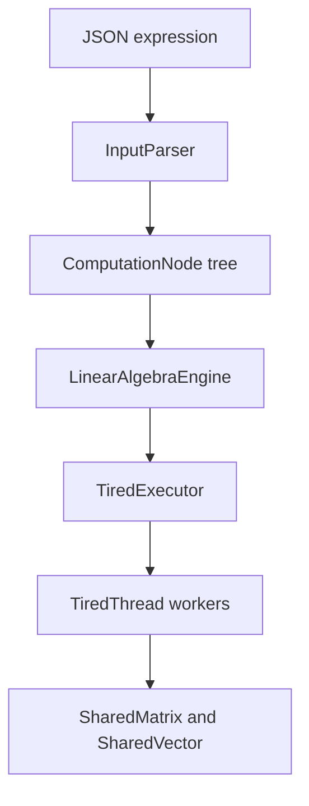

# MatrixLab

**A concurrent matrix-expression engine with a performance playground.**

Evaluate JSON expressions, inspect how work is distributed across a custom worker pool, and compare the engine with a direct serial implementation using **Matrix Race**.

Java 17 · Maven · Jackson · JUnit 5

## Quick demo

The downloadable project includes a prebuilt JAR in `release/`. Install Java 17 or newer, open a terminal in this folder, then run:

```powershell
java -version
java -jar release/matrixlab-1.0.0.jar solve 4 examples/example1.json result.json
java -jar release/matrixlab-1.0.0.jar race 128 4 5 results 42
```

Open `results/matrix-race.html` in your browser. On Windows PowerShell:

```powershell
Start-Process .\results\matrix-race.html
```

You can also open `demo-preview/matrix-race.html` immediately to inspect an actual report generated during validation. Its measurements are specific to that run and machine.

## Build from source

Requirements: **JDK 17+** and **Maven 3.9+** on `PATH`. The first build downloads dependencies from Maven Central.

```powershell
mvn clean verify
java -jar target/matrixlab-1.0.0.jar --help
java -jar target/matrixlab-1.0.0.jar solve 4 examples/example1.json result.json
java -jar target/matrixlab-1.0.0.jar race 256 4 7 results 42
```

These commands also work in Bash. Build a fresh JAR after changing source code; the bundled release JAR is a snapshot of this version.

## Expression format

```json
{
  "operator": "+",
  "operands": [
    {"operator": "*", "operands": [[[1, 2]], [[3], [4]]]},
    [[5]]
  ]
}
```

This computes `[[16]]`.

| Operator | Meaning | Operands |
|---|---|---|
| `+` | Element-wise matrix addition | Two or more, equal shapes |
| `*` | Matrix multiplication | Two or more, compatible inner dimensions |
| `-` | Unary negation | Exactly one |
| `T` | Transpose | Exactly one |

Matrices must be non-empty, rectangular, and contain finite numbers. N-ary addition/multiplication are evaluated left-associatively without reordering operands. The result file contains `{"result": [[...]]}`. Invalid solves return a nonzero process exit code and attempt to write an error JSON file. The older CLI form `<workers> <input> <output>` remains supported.

## Matrix Race

```text
race [matrixSize=128] [maxWorkers=4] [repetitions=5] [outputDirectory=results] [seed=42]
```

The default worker cap is the smaller of 4 and the JVM's reported processor count. Explicit worker counts are limited to 32, size to 1024, and repetitions to 100. Large experiments can take time and allocate substantial memory.

- Generates one seeded pair of square matrices shared across modes.
- Compares a direct serial triple-loop kernel with the actual expression engine using 1, 2, 4, ... workers, plus the requested maximum when needed.
- Warms each mode three times and shuffles mode order each round using a seed.
- Reports the median of measured runs, not the fastest run.
- Uses a fresh expression tree for every evaluation because the engine resolves nodes in-place.
- Verifies every output against the serial reference with relative/absolute tolerance.
- Exports HTML, CSV, and JSON, including worker task counts, failures, and timing metrics.

**Interpretation:** speedup = serial median / engine median. Below 1 means slower. Engine timing includes validation, matrix copies, locks, scheduling, arithmetic, and result assembly. It excludes worker startup, input generation, expression construction, numerical checks, and report file writes. The serial mode includes output allocation and arithmetic. This deliberately compares application-level costs; it does not isolate parallel arithmetic speedup.

Worker task counts include warmups. Inputs and order are reproducible; timings and task allocation are affected by the OS and are not deterministic. This is an educational performance experiment, not a JMH microbenchmark or a universal speedup claim. Small matrices can favor serial execution.

## Design



- **Expression tree:** recursive normalization preserves all operands; resolution turns completed operation nodes into matrix nodes.
- **Custom executor:** blocking backpressure and a single-slot handoff per worker. Idle workers are prioritized by accumulated runtime multiplied by a seeded weight.
- **Scheduling score:** “fatigue” is a simulated weighted-runtime score. It is not CPU utilization, temperature, or actual hardware fatigue.
- **Completion:** workers update metrics before re-entering the priority queue. A batch tracks only its own accepted tasks and reports errors after those tasks finish.
- **Memory:** vectors own their arrays; locks use `try/finally`. Reciprocal additions acquire locks in a stable order. Multiplication shares one read-only right-matrix snapshot across row tasks, avoiding per-scalar locking in the arithmetic loop.
- **Lifecycle:** `AutoCloseable` supports reliable cleanup. Shutdown stops acceptance, drains work, and joins workers. Interrupted callers retain their interrupt status; accepted work drains before failure is reported.

See [architecture](docs/ARCHITECTURE.md), [changes](docs/CHANGES.md).

## Tests

`mvn test` runs JUnit 5 through Maven Surefire. Coverage includes supplied expression examples, malformed input, rectangular products, immutable operands, nested n-ary expressions, worker exceptions, reuse after failure, shutdown, interrupted callers, concurrent submissions, lock ordering, and report generation. See [validation](docs/VALIDATION.md) for the recorded run.

## Scope and limitations

- Operations within one expression are resolved sequentially; rows within an operation run concurrently. Independent expression branches are not scheduled as a DAG.
- One engine serializes `run()` calls and mutates input trees. Do not share or mutate an input tree while it is being evaluated.
- A failed expression may already have resolved earlier child nodes. The engine does not provide transactional rollback; create a fresh tree for a retry.
- Matrix multiplication uses the conventional O(mkn) algorithm, with no BLAS, GPU, or cache tiling.
- `submit()` is fire-and-forget and exposes failure counts in telemetry. Use `submitAll()` when the caller needs errors propagated.
- Tasks that never return cannot be forcibly cancelled. Graceful shutdown waits for accepted tasks; it has no timeout. Nested blocking submissions from the pool's own workers are rejected.
- The memory classes provide lock-based primitives. External callers must not mix structural loads/transposes with arbitrary operations on the same matrix and assume a whole-matrix transaction.
- Matrix Race has no statistical confidence intervals or process forks. Use JMH/profiling before making performance claims.

## Origins and attribution

The original engine was a collaborative university project by **Guy Abramovich and Itay Erenreich**. This portfolio edition adds reliability fixes, regression tests, Matrix Race, a runnable distribution, and revised documentation. The modernization was developed with AI assistance; contributors should review and understand the changes before presenting them.

The original submission instructions and personal identification numbers are excluded. Existing Java package names are retained for compatibility. See `NOTICE.md` for attribution. No new license or ownership rights are implied.
